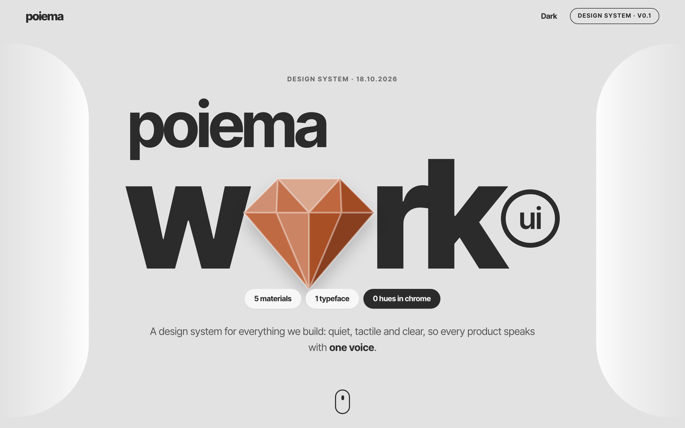
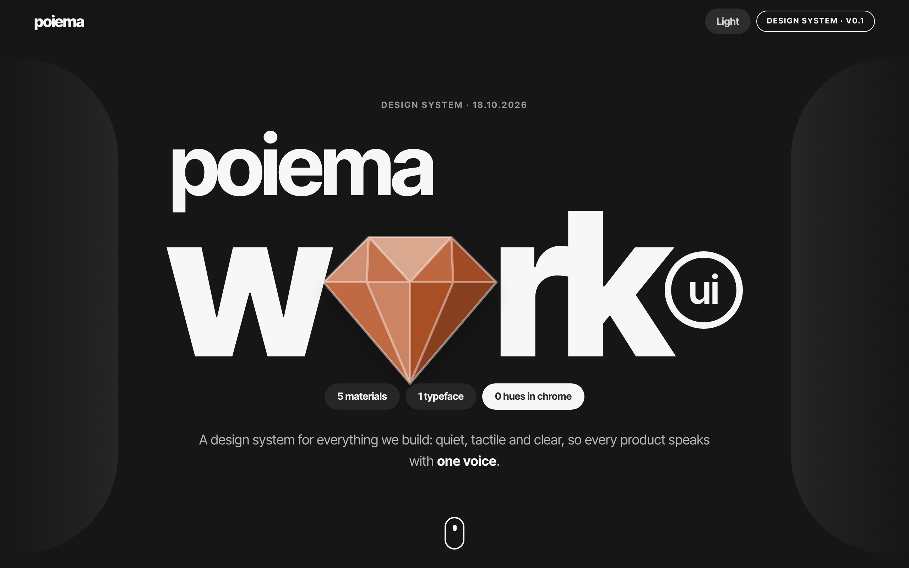
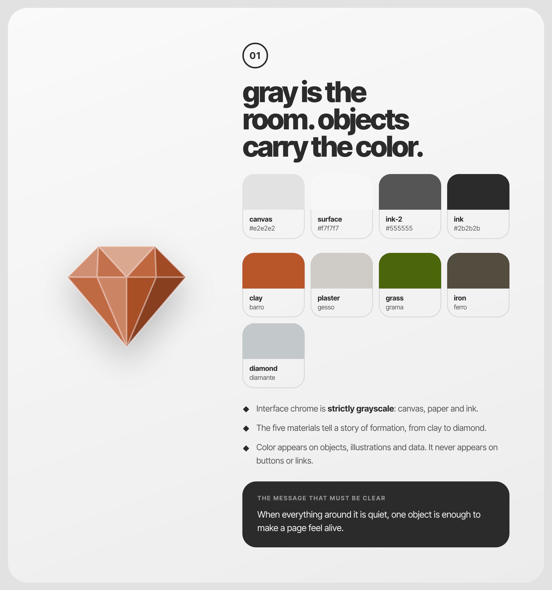
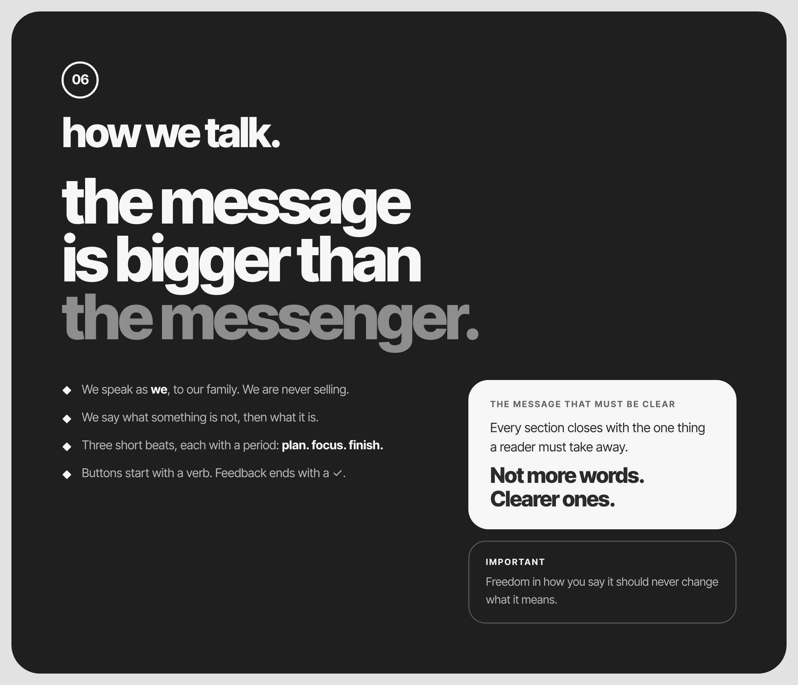
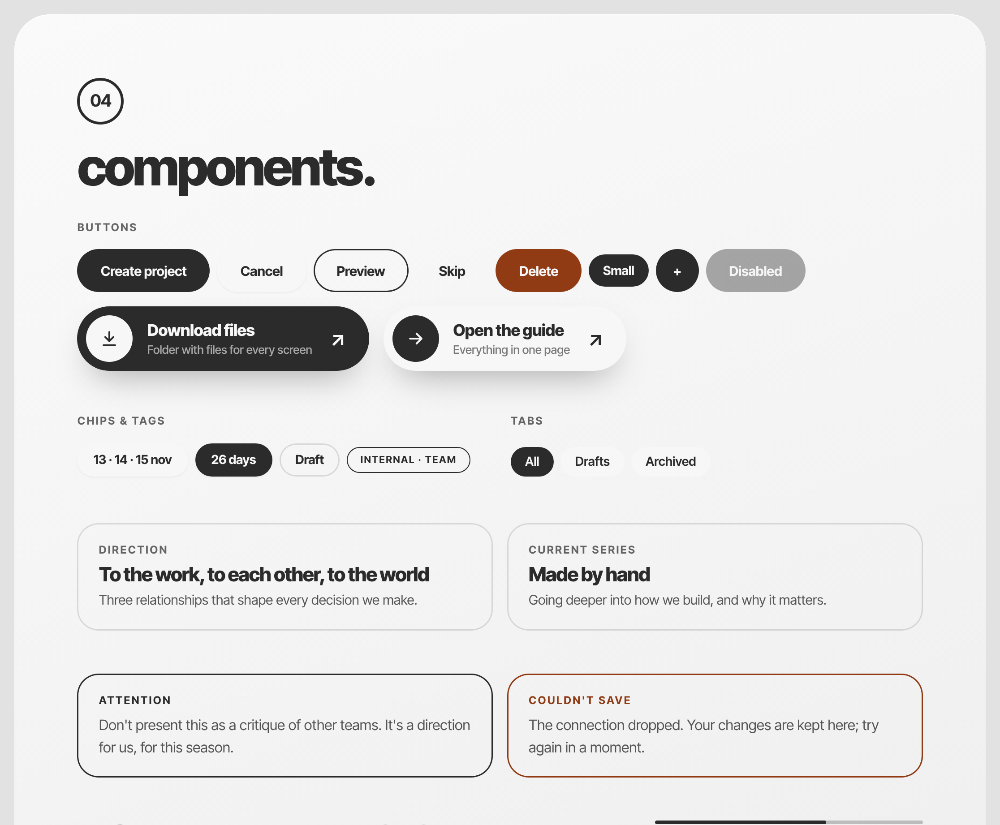
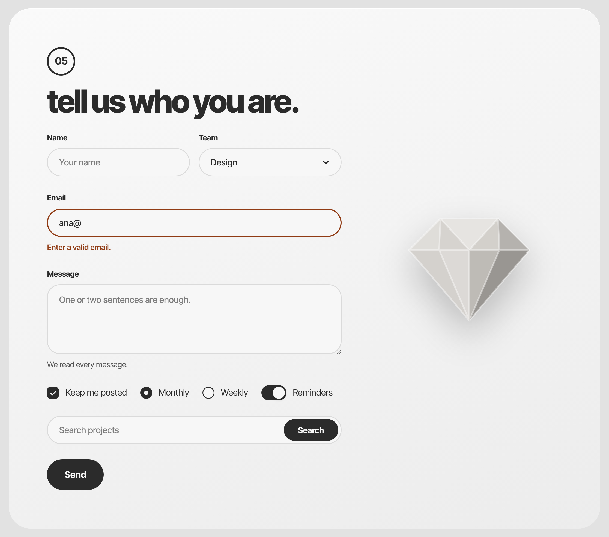
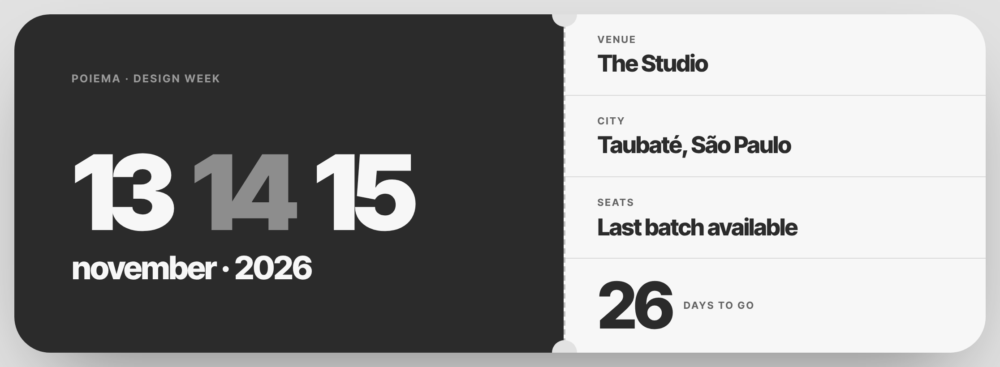
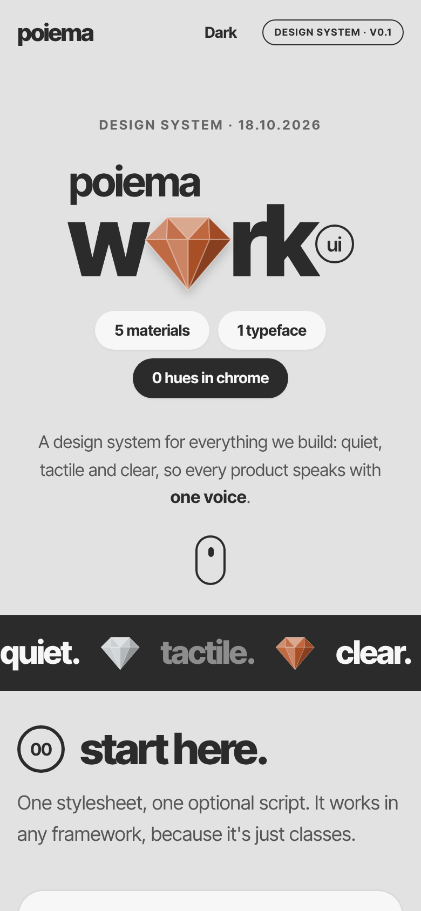
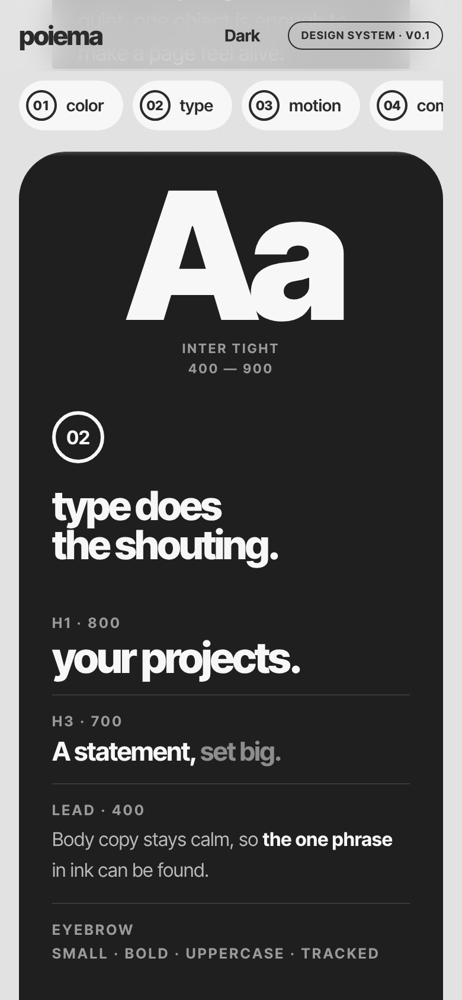
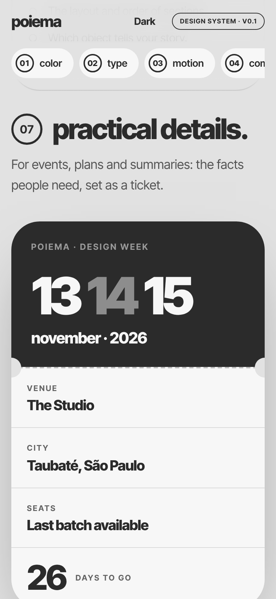

# poiema-ui

**The Poiema design system:** a quiet gray gallery, huge lowercase type, soft 40px cards, ringed numbers, tactile objects that carry the only color, and a sincere, communal voice. Extracted from the [Poiema Conf 26 direction page](https://poiema-conference-direcionamento.pages.dev/) and generalized for any web app Poiema builds.

> **Proprietary.** For use by Poiema and the people working on its behalf only. See [LICENSE](LICENSE).



- **Framework-agnostic.** It's plain CSS (`pm-*` classes + `--pm-*` tokens), so it works with Next.js, SvelteKit, Vue, Astro, Rails, Django or a static page.
- **Small JS, optional.** Behaviors for scroll reveal, tilt, material swap, copy feedback, dialogs and toasts. They are SSR-safe and typed, with zero dependencies.
- **Tailwind v4 ready.** One import maps the tokens to `bg-canvas text-ink-2 rounded-card text-h1 animate-float`…
- **Agent-ready.** `AGENTS.md`, `llms.txt`, full docs, and three Claude skills: **poiema-design**, **poiema-voice** and **poiema-review**.

```html
<section class="pm-section pm-container">
  <header class="pm-section-head">
    <span class="pm-ring">01</span>
    <h2 class="pm-h1">your projects.</h2>
    <p>Everything each goal needs, in one place.</p>
  </header>
  <article class="pm-card" data-pm-reveal>
    <ul class="pm-list"><li>One owner, one outcome.</li><li>Every task has <strong>a date</strong>.</li></ul>
  </article>
</section>
```

## Install

```bash
npm i github:Poiema-Tech/poiema-ui#semver:^0.2.1
```
The repository is private, so the machine running the install needs GitHub access to it (an SSH key or `gh auth login`). Deploy and CI environments need a read-only deploy key or token. The package is never published to npm (`"private": true`).

```js
import 'poiema-ui/css';            // tokens + components (once, at the app root)
import { init } from 'poiema-ui';  // optional behaviors: call init() once on the client
```

No bundler? Copy `dist/poiema.min.css` and `dist/poiema.auto.js` into the site's own static files and link them (there is no public CDN, on purpose):
```html
<link rel="stylesheet" href="https://fonts.googleapis.com/css2?family=Inter+Tight:wght@400;500;600;700;800;900&display=swap">
<link rel="stylesheet" href="/vendor/poiema/poiema.min.css">
<script defer src="/vendor/poiema/poiema.auto.js"></script>
```

Framework recipes (Next.js, SvelteKit actions, Vue directives, Astro, Tailwind v4, tokens in JS) are in **[docs/frameworks.md](docs/frameworks.md)**.

## Teach your AI

```bash
npx poiema-ui init
```
This copies the three skills into `.claude/skills/` and adds a short Poiema section to your `AGENTS.md` (and to `CLAUDE.md` if you have one, importing the full rules). Codex, Cursor, Copilot and other agents that read `AGENTS.md` pick it up. Claude Code picks up the skills too.

Or install the skills globally as a Claude Code plugin (needs GitHub access to this private repo):
```
/plugin marketplace add Poiema-Tech/poiema-ui
/plugin install poiema@poiema
```

Other tools can read [`llms.txt`](llms.txt) (index) or [`llms-full.txt`](llms-full.txt) (everything in one file).

| Skill | Use it to |
|---|---|
| `poiema-design` | build or restyle pages, screens and components |
| `poiema-voice` | write headlines, microcopy, empty states and errors (pt-BR and en) |
| `poiema-review` | audit a page, diff or screenshot and list or apply fixes |

## Versions

Every release is a git tag (`v0.2.0`) with a GitHub release that lists its commits. The same list goes into [CHANGELOG.md](CHANGELOG.md), which ships in the package. Apps install a version range, not `main`:

```bash
npm i github:Poiema-Tech/poiema-ui#semver:^0.2.1
```

- **Take fixes and additions:** `npm update poiema-ui` (or `pnpm update poiema-ui`) moves to the newest release in the range.
- **Cross a breaking release:** read the changelog, then raise the range in `package.json`. While the version starts with `0.`, any minor release may break; from `1.0.0` on, only a major does.
- **Keep the agent skills in step:** add `"postinstall": "poiema-ui init"` to the app's scripts, so every install refreshes `.claude/skills/` and the Poiema section of `AGENTS.md`.

To cut a release, run the **Release** workflow (Actions → Release → Run workflow, or `gh workflow run release.yml -f bump=patch`) and pick the bump: `patch` for docs, skills and fixes, `minor` for new components or tokens, `major` for renamed or removed classes and tokens, or rules that make agents rewrite existing screens. It bumps the version, rebuilds, updates the changelog, tags and publishes the release.

## What was extracted

| | |
|---|---|
| **Conversation style** | lowercase headlines ending in a period · triads (`from christ. in us. to the world.`) · "not X — Y" reframes · a "message that must be clear" callout, on request · freedom vs. boundaries (✓ / ○) · calm alerts · verb-first buttons, "Copied ✓" → [docs/voice.md](docs/voice.md) |
| **Tone & mood** | quiet gray gallery, sincere and communal, editorial poster type, tactile objects, reverent but contemporary → [docs/principles.md](docs/principles.md) |
| **Colors** | grayscale chrome (`#e2e2e2` canvas, `#f7f7f7` paper, `#2b2b2b` ink) + five sampled materials: clay, plaster, grass, iron, diamond → [docs/color.md](docs/color.md) |
| **Animations** | rise-and-settle reveal (900ms, `cubic-bezier(.2,.8,.2,1)`), 7s float, pointer tilt, material cross-fade, 40s marquee, -2px lift → [docs/motion.md](docs/motion.md) |
| **Fonts** | Inter Tight 400–900, 800 headlines at -0.05em, 900 numerals at -0.07em, 12px uppercase eyebrows at +0.14em → [docs/typography.md](docs/typography.md) |

## Showcase

Every image below is a screenshot of [`demo/index.html`](demo/index.html), a kitchen-sink page built only from this package. Open it locally with `npm run demo`, then visit http://localhost:4173/demo/. The live page adds the motion: scroll reveals, floating gems, tilt and the material swap.

**Dark theme.** One attribute, `data-theme="dark"`, flips every token. Solid buttons and callouts invert on their own.



**Feature card.** A floating object, a ringed number, a lowercase title, diamond bullets and the closing callout.



**Rhythm by inversion.** A dark card, the gray "echo" in display type, and a callout that turns to paper on dark.



**Components.** Buttons, the rich call to action, chips, tags, tabs, tiles and calm alerts.



**Forms.** Pill fields, an ink focus ring, a clay error state, and the ring-shaped radio.



**Ticket.** Facts set as a stub, for events, plans and summaries.



**Mobile.** Everything collapses to one column at 390px with no horizontal scroll.

<p>
  
  
  
</p>

## Develop

```bash
npm run build   # dist/, docs/tokens.md, contrast table, skill references, llms-full.txt
npm test        # build + unit tests (fails if a contrast pair regresses)
npm run screenshots   # regenerate screenshots/ from the demo (needs: npm i --no-save playwright)
```
`src/tokens.json` is the single source of truth. See the bottom of [AGENTS.md](AGENTS.md) for repo conventions.

## License

Proprietary. © Poiema, all rights reserved. Only Poiema and the people it authorizes (staff, volunteers, contractors, and AI tools working on its behalf) may use this material, and only for Poiema's own projects. Don't publish it to npm or any public CDN, and don't copy it into projects outside Poiema. Full terms (Portuguese, with an English translation): [LICENSE](LICENSE).
